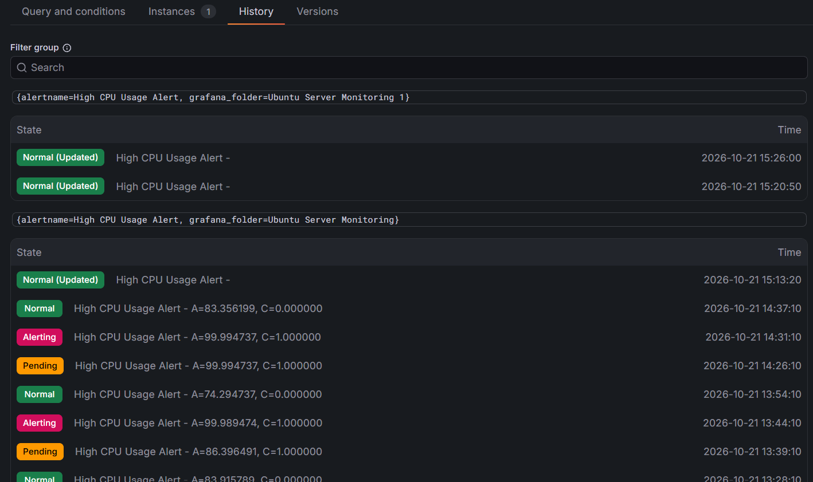

# Ubuntu Server Monitoring & Automated Alerting System

A personal IT infrastructure monitoring project built using **Ubuntu Server, Prometheus, Node Exporter, and Grafana**, deployed in a VMware Workstation virtual environment.

This project focuses on monitoring server performance, visualizing system metrics, and implementing automated email notifications when resource usage exceeds predefined thresholds.

## Tech Stack

- **Operating System:** Ubuntu Server
- **Virtualization:** VMware Workstation
- **Metrics Collection:** Prometheus
- **System Metrics Exporter:** Node Exporter
- **Monitoring & Visualization:** Grafana
- **Alerting:** Grafana Alerting
- **Email Notifications:** Gmail SMTP

## Key Features

### Real-Time Server Monitoring
A custom Grafana dashboard visualizes essential server metrics, including:

- CPU Usage (%)
- RAM Usage (%)
- Disk Usage (%)
- Network Traffic
- Server Uptime
- Server Status
- CPU Load Average
- Disk I/O Activity

### Automated Alerting
Grafana alert rules are configured to monitor critical system resources.

| Alert Rule | Threshold | Pending Period |
|---|---|---|
| High CPU Usage | Above 85% | 5 minutes |
| High RAM Usage | Above 85% | 5 minutes |
| High Disk Usage | Above 85% | Configured |

Email notifications are delivered through Gmail SMTP when alert conditions are met.

## System Architecture

```text
Ubuntu Server (VMware Workstation)
             |
             v
        Node Exporter
             |
             v
         Prometheus
             |
             v
           Grafana
          /       \
         v         v
    Dashboard   Alert Rules
                    |
                    v
               Gmail SMTP
                    |
                    v
             Email Notification
```

## Testing & Validation

The monitoring and alerting system was tested to verify its functionality.

- **CPU Alert:** Successfully triggered through CPU stress testing.
- **RAM Alert:** Successfully triggered through temporary threshold adjustment.
- **Email Notification:** Successfully delivered through Gmail SMTP.
- **Disk Alert:** Configured but not yet tested.

After testing, the RAM alert threshold was restored to its original value of 85%.

## Grafana Dashboard
### Monitoring Dashboard Screenshots


The exported Grafana dashboard configuration is included in this repository as a JSON file.

It can be imported into a compatible Grafana instance and connected to a Prometheus data source.

## Project Objectives

- Gain hands-on experience with Linux server administration.
- Understand infrastructure monitoring and system observability.
- Implement real-time monitoring using open-source tools.
- Configure automated alerts for server resource utilization.
- Practice troubleshooting and monitoring system performance.

## Future Improvements

- Organize and expand monitoring documentation.
- Add more advanced alerting rules.
- Implement additional infrastructure monitoring targets.
- Explore centralized logging and monitoring integrations.

## Project Status

**Completed — Core monitoring and alerting functionality implemented.**

This project was developed as part of independent learning and practical experience in IT infrastructure, Linux administration, and monitoring systems.
## Automated Alerting System

The monitoring system uses Grafana Alerting to detect high resource usage and send automated email notifications via Gmail SMTP.

### Configured Alert Rules


Three alert rules are configured to monitor CPU, RAM, and disk usage.

### CPU Alert Testing Results



The CPU alert was successfully triggered during stress testing, transitioning from Normal to Pending and Alerting before returning to Normal.
